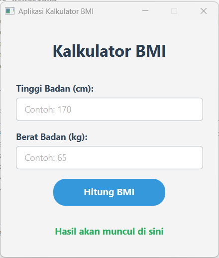

# Membuat Kalkulator BMI dengan JavaFX 🧮

## Identitas Diri
**Nama:** Affan Lie Dhiyaa'ulrahman
**Kelas:** 3A MKB
**NIM:** 2506463

## Fitur Utama
* **Perhitungan Otomatis:** Menghitung nilai BMI secara instan berdasarkan formula standar.
* **Kategorisasi Hasil:** Mengelompokkan hasil ke dalam kategori (Kurus, Normal, Overweight, Obesitas).
* **Validasi Input:** Menangani *error* jika pengguna memasukkan huruf atau membiarkan kolom input kosong.
* **UI Kustom:** Antarmuka pengguna yang bersih dan modern menggunakan FXML dan CSS.

## Teknologi yang Digunakan
* Java (JDK 17+)
* JavaFX (Controls & FXML)
* Apache Maven
* NetBeans IDE

## Cara Menjalankan
1. Pastikan JDK dan Maven sudah terinstal di sistem Anda.
2. *Clone* repositori ini: 
   `git clone https://github.com/AFFAN-lie/KalkulatorBMI-TugasPromlan.git`
3. Buka terminal di direktori proyek dan jalankan perintah berikut:
   ```bash
   mvn clean javafx:run

## Tampilan UI
